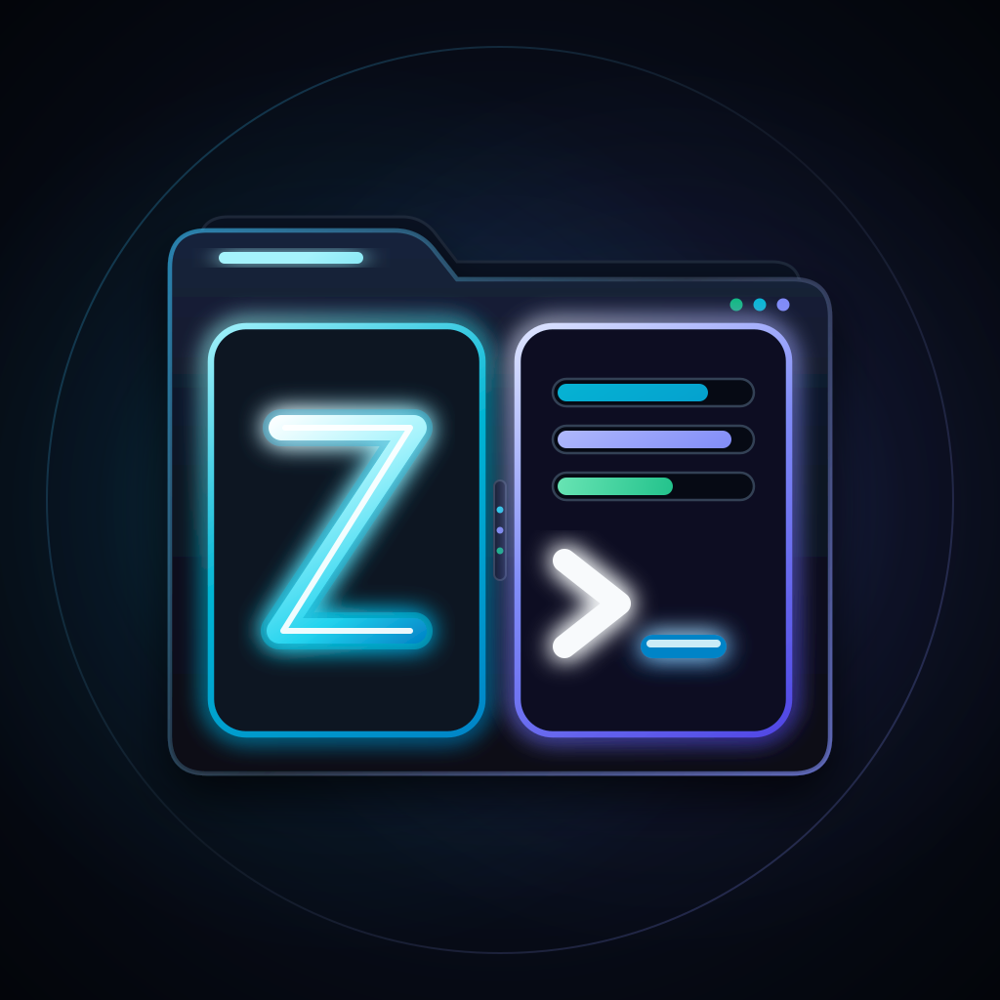

<div align="center">

  <a href="https://zilore.app">
    
  </a>

  <h1>⚡ Zilore Files</h1>

  <p>
    <strong>Системный двухпанельный файловый менеджер, сетевой хаб и аппаратный медиа-комбайн для Android &amp; Android TV (Android 8.0 – 17 Ready)</strong>
  </p>

  <p>
    <a href="https://zilore.app"></a>
    <a href="https://t.me/zilorefiles"></a>
    <a href="https://t.me/zilorechat"></a>
  </p>

  <p>
    
    
    
    
    
    
  </p>

  <h4>
    <a href="#-архитектура-проекта">🏗 Архитектура</a> •
    <a href="#-спецификация-модулей-и-пакетов">📦 Таблица модулей</a> •
    <a href="#-безопасность-и-проверка-sha-256">🛡 SHA-256 и Android 16/17</a> •
    <a href="#-сообщество-и-поддержка">💬 Сообщество</a>
  </h4>

</div>

---

> 🌐 **Интерактивный веб-стенд и проверка APK:** откройте официальный портал **[zilore.app](https://zilore.app)** (или локальный файл [`index.html`](./index.html)), чтобы протестировать двухпанельный командир `ExplorerDualPaneCommander` прямо в браузере, изучить экранные модули и локально сверить контрольную сумму `SHA-256` скачанного `.apk` файла через Web Crypto API.

**Zilore Files** — многофункциональное двухпанельное приложение на базе выделенной модульной архитектуры (`:app` + `:core:fs-engine`) для смартфонов, планшетных ПК, ТВ-приставок и **4K Smart TV** (с полной поддержкой **Android 8.0 – Android 16 / 17**). Объединяет низкоуровневый драйвер `UsbBulkScsiEngine` для чтения/записи **EXT4 / NTFS / exFAT** без Root-прав, мультипротокольный сетевой хаб и **5 облачных клиентов** (**SFTP, SMB, FTP, WebDAV, DLNA + Google Drive, Dropbox, Yandex Disk, Mail.ru Cloud, NextCloud**), единый маршрутизатор форматов `FileViewerRouter`, студийную ТВ-оболочку `SettingsTvStudioShell`, аппаратный медиаплеер **AV1 / Dolby Vision / Hi-Res Audio**, встроенный просмотрщик **Word (DOCX), Excel (XLSX/CSV), PDF и графики**, **HEX-инспектор**, биометрическую защиту `ZiloreBiometricAndClipboardGuard` и криптосейф **ZiloreCryptoVault (AES-256-GCM)**.

---

## 🏗 Архитектура проекта

Проект разделён на два независимых Gradle-модуля (`:app` и `:core:fs-engine`), связанных полнодуплексным реактивным мостом `Zilore VFS Bridge`. Для идеальной читаемости на любых экранах архитектура визуализирована в **3 отдельных широкоформатных анимированных SVG-схемах**:

### 1. Полнодуплексный мост данных `Zilore VFS Bridge` (`:app ⇄ :core:fs-engine`)
Отображает обмен состояниями и данными между пользовательским интерфейсом и низкоуровневым файловым ядром через `Kotlin StateFlow`, пул прямых буферов `ZiloreByteBufferPool (Zero-Copy DMA)` и потоковый прокси `ZiloreRemoteStreamProxy`:

<p align="center">
  
</p>

### 2. Пользовательский модуль `:app` (UI Screens, FileViewerRouter, 4K TV Studio & Security)
Раскрывает 4 подсистемы уровня приложения: модульный проводник, маршрутизатор `FileViewerRouter` и экранные комбайны (`ui/screens/`), студийную оболочку `SettingsTvStudioShell` с секциями `SettingsHardwareDiagnosticsSection` и `SettingsSecurityAuditSection` для **4K Android TV** (`tv/` и `ui/components/`), фоновые службы, центр уведомлений `ZiloreNotificationHub` и инсталлятор сплитов (`installer/`, `service/`, `sync/`), а также биометрическую защиту `ZiloreBiometricAndClipboardGuard` и контроль разрешений **Android 16 / 17**:

<p align="center">
  
</p>

### 3. Низкоуровневое ядро `:core:fs-engine` (VFS, USB SCSI, 5 Clouds & CryptoVault)
Детализирует 4 системных ядра: виртуальную файловую систему (`FileEngine`, `ZiloreByteBufferPool`, `RealtimeDirectoryWatcher`), собственный **User-Space USB Bulk SCSI драйвер** (`UsbBulkScsiEngine`, `UsbRawPartitionReader` без Root-прав), сетевой и облачный стек (`SFTP/SMB/WebDAV/DLNA` + **5 Облаков** + встроенные серверы с `assets/webstudio/index.html` и `ZiloreWebThumbnailRenderer`) и криптосейф `ZiloreCryptoVault (AES-256-GCM)`:

<p align="center">
  
</p>

---

## 📦 Спецификация модулей и пакетов

<table>
  <thead>
    <tr>
      <th width="22%">Модуль и слой</th>
      <th width="22%">Пакеты</th>
      <th width="56%">Ключевые классы и назначение</th>
    </tr>
  </thead>
  <tbody>
    <tr>
      <td><b><code>:app</code><br>Explorer &amp; Router UI</b></td>
      <td><code>ui/screens/</code></td>
      <td><code>ExplorerDualPaneCommander</code>, <code>ExplorerScreen</code>, <code>FileViewerRouter</code>, <code>ExplorerBatchAndClipboardBars</code>, <code>ExplorerSafBrowserList</code>, <code>ExplorerActionModals</code>, <code>NetworkScreen</code>, <code>NetworkLocalServersSection</code>, <code>NetworkRemoteFileBrowserSection</code>, <code>NetworkUsbOtgSection</code>, <code>SftpServerMonitorCard</code></td>
    </tr>
    <tr>
      <td><b><code>:app</code><br>Media, Office &amp; Dev</b></td>
      <td><code>ui/screens/</code></td>
      <td><code>VideoPlayer</code>, <code>ZiloreAudioEngine</code>, <code>AudioPlayerScreen</code>, <code>WordDocumentScreen</code>, <code>SpreadsheetViewerScreen</code>, <code>PdfViewerScreen</code>, <code>EditorPdfScreen</code>, <code>ImageViewerScreen</code>, <code>HexBinaryViewerScreen</code>, <code>SshInteractivePtyModal</code>, <code>TerminalScreen</code>, <code>TextEditorScreen</code>, <code>ArchiveViewerModal</code></td>
    </tr>
    <tr>
      <td><b><code>:app</code><br>TV Studio &amp; Settings</b></td>
      <td><code>tv/</code><br><code>ui/screens/</code><br><code>ui/components/</code></td>
      <td><code>SettingsTvStudioShell</code>, <code>SettingsHardwareDiagnosticsSection</code>, <code>SettingsSecurityAuditSection</code>, <code>ZiloreTvChannelPublisher</code>, <code>ZiloreTvKeyboardAndVoice</code>, <code>ZiloreTvModifiers</code>, <code>ZiloreStorageAnalyzerDialog</code>, <code>ZiloreAppManagerDialog</code>, <code>ZiloreQrCodeBox</code>, <code>StorageVolumeCard</code>, <code>FileRichThumbnailBox</code></td>
    </tr>
    <tr>
      <td><b><code>:app</code><br>Services &amp; Hub</b></td>
      <td><code>installer/</code><br><code>service/</code>, <code>sync/</code><br><code>notifications/</code>, <code>media/</code></td>
      <td><code>PackageInstallerService</code>, <code>InstallReceiver</code>, <code>WifiTransferForegroundService</code>, <code>FolderSyncManager</code>, <code>ZiloreNotificationHub</code>, <code>FilePreviewEngine</code>, <code>ZiloreCodecRegistry</code></td>
    </tr>
    <tr>
      <td><b><code>:app</code><br>Security &amp; Android 16/17</b></td>
      <td><code>security/</code><br><code>diagnostics/</code><br><code>permissions/</code>, <code>updater/</code></td>
      <td><code>ZiloreBiometricAndClipboardGuard</code>, <code>ZilorePermissionCenter</code> <b>(Android 8.0 – 16/17 Ready)</b>, <code>ZiloreCpuAndHardwareInspector</code>, <code>ZiloreSecurityAuditor</code>, <code>ZiloreCrashLogDispatcher</code>, <code>ZiloreAnonymousDiagnostics</code>, <code>GithubUpdater</code>, <code>ZiloreBatteryOptimizer</code>, <code>ZiloreSettingsStore</code></td>
    </tr>
    <tr>
      <td><b><code>:core:fs-engine</code><br>VFS &amp; USB SCSI</b></td>
      <td><code>engine/</code>, <code>vfs/</code><br><code>watcher/</code>, <code>tasks/</code><br><code>usb/</code></td>
      <td><code>FileEngine</code>, <code>ZiloreVfs</code>, <code>ZiloreByteBufferPool</code> (Zero-Copy), <code>ZiloreHardwareProfiler</code>, <code>RealtimeDirectoryWatcher</code>, <code>FileOperationTaskQueue</code>, <code>UsbBulkScsiEngine</code> (до <code>348 MB/s</code>), <code>UsbRawPartitionReader</code> (<code>EXT4</code>/<code>NTFS</code>/<code>exFAT</code>), <code>UsbOtgDriver</code>, <code>UsbOtgMonitor</code></td>
    </tr>
    <tr>
      <td><b><code>:core:fs-engine</code><br>Network &amp; 5 Clouds</b></td>
      <td><code>network/</code><br><code>assets/webstudio/</code></td>
      <td><code>SftpServiceModule</code>, <code>SmbServiceModule</code>, <code>FtpServiceModule</code>, <code>WebDavServiceModule</code>; <b>5 Облаков:</b> <code>GoogleDriveServiceModule</code>, <code>DropboxServiceModule</code>, <code>YandexDiskServiceModule</code>, <code>MailRuCloudServiceModule</code>, <code>NextCloudServiceModule</code>; <b>Серверы:</b> <code>ZiloreWifiTransferServer</code>, <code>ZiloreWebStudioTemplate</code>, <code>ZiloreWebThumbnailRenderer</code>, <code>ZiloreEmbeddedFtpServer</code>, <code>ZiloreEmbeddedWebDavServer</code>, <code>ZiloreDlnaCastServer</code>, <code>ZiloreRemoteStreamProxy</code>, <code>ZiloreLocalTlsProvider</code></td>
    </tr>
    <tr>
      <td><b><code>:core:fs-engine</code><br>Parsers &amp; CryptoVault</b></td>
      <td><code>document/</code>, <code>spreadsheet/</code><br><code>archive/</code>, <code>security/</code><br><code>inspector/</code></td>
      <td><code>OfficeDocumentParser</code> (<code>DOCX</code>), <code>SpreadsheetParser</code> (<code>XLSX</code>/<code>CSV</code>), <code>ArchiveManager</code> (<code>zip4j</code>/<code>junrar</code>/<code>7z</code>/<code>TAR</code>), <code>ZiloreCryptoVault</code> (<code>AES-256-GCM</code>), <code>ZiloreKeyStoreHelper</code>, <code>BinaryHeaderInspector</code>, <code>LocalShellSession</code></td>
    </tr>
  </tbody>
</table>

---

## 🛡 Безопасность и проверка SHA-256

Перед установкой APK-файла рекомендуется сверить его контрольную сумму `SHA-256` (вручную через терминал, автоматически через встроенный `GithubUpdater` или локально в браузере на странице **[zilore.app](https://zilore.app)**).

* **Имя пакета:** `ZiloreFiles-universal.apk` (`ARM64-v8a` / `armeabi-v7a` / `x86_64`)
* **Эталонный `SHA-256`:**
  ```text
  8f434346648f6b96df89dda901c5176b10a6d83961dd3c1ac88b59b2dc327aa4
  ```

### Матрица защиты подсистем (`Security Hardening v26.1 — Android 16/17 Ready`)

<table>
  <thead>
    <tr>
      <th width="26%">Узел / Компонент</th>
      <th width="30%">Вектор угрозы</th>
      <th width="44%">Реализованная защита в Zilore Files</th>
    </tr>
  </thead>
  <tbody>
    <tr>
      <td><b><code>ZiloreCryptoVault</code></b></td>
      <td>Несанкционированный доступ к приватным файлам</td>
      <td>Шифрование <code>AES-256-GCM</code> с хранением мастер-ключей в аппаратном <code>Android Keystore (TEE)</code></td>
    </tr>
    <tr>
      <td><b><code>BiometricClipboardGuard</code></b></td>
      <td>Перехват паролей из буфера обмена и несанкционированный вход</td>
      <td>Биометрическая верификация и автоматическая очистка буфера обмена по таймеру</td>
    </tr>
    <tr>
      <td><b><code>ZilorePermissionCenter</code></b></td>
      <td>Ограничения Scoped Storage и фоновых служб в <b>Android 16 / 17</b></td>
      <td>Гранулярный контроль разрешений <code>MANAGE_EXTERNAL_STORAGE</code>, Foreground Service Types и USB OTG</td>
    </tr>
    <tr>
      <td><b><code>ZiloreSecurityAuditor</code></b></td>
      <td>Компрометация среды исполнения или сетевых политик</td>
      <td>Аудит SELinux, Keystore, <code>network_security_config.xml</code> и целостности окружения</td>
    </tr>
    <tr>
      <td><b><code>ArchiveManager</code></b></td>
      <td><i>Zip-Slip (Path Traversal)</i> при распаковке архивов</td>
      <td>Каноническая проверка путей <code>File.canonicalPath</code> до записи любого байта на диск</td>
    </tr>
    <tr>
      <td><b><code>WifiTransferServer</code></b></td>
      <td>Перехват трафика в локальной Wi-Fi сети</td>
      <td>Генерация сертификатов в <code>ZiloreLocalTlsProvider</code> (HTTPS) + авторизация по QR-коду</td>
    </tr>
    <tr>
      <td><b><code>ZiloreCrashLogDispatcher</code></b></td>
      <td>Утечка приватных путей и имён файлов в логах</td>
      <td>Полное отсутствие фоновой телеметрии; санитизация стектрейсов в <code>ZiloreAnonymousDiagnostics</code></td>
    </tr>
  </tbody>
</table>

---

## 💬 Сообщество и поддержка

* 🌐 **Официальный сайт и проверка SHA-256:** [https://zilore.app](https://zilore.app)
* 📢 **Telegram-канал релизов:** [@zilorefiles](https://t.me/zilorefiles)
* 💬 **Технический форум поддержки:** [@zilorechat](https://t.me/zilorechat)
* 📧 **Почта для отчётов и предложений:** [ziloreapp@gmail.com](mailto:ziloreapp@gmail.com)
