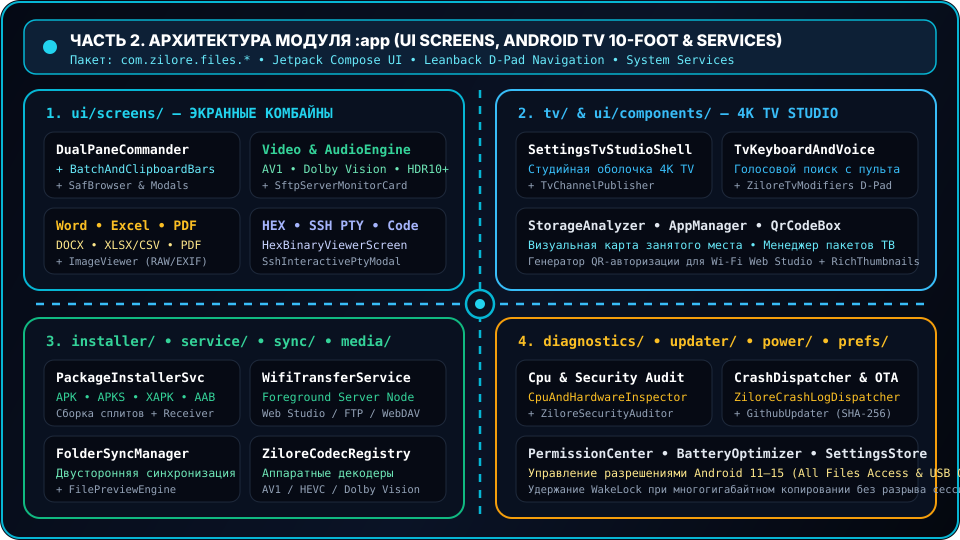

<div align="center">

  <a href="https://zilore.app">
    
  </a>

  <h1>⚡ Zilore Files</h1>

  <p>
    <strong>Системный двухпанельный файловый менеджер, сетевой хаб и аппаратный медиа-комбайн для Android &amp; Android TV</strong>
  </p>

  <p>
    <a href="https://zilore.app"></a>
    <a href="https://t.me/zilorefiles"></a>
    <a href="https://t.me/zilorechat"></a>
  </p>

  <p>
    
    
    
    
    
    
  </p>

</div>

---

> 🌐 **Официальный портал и проверка APK:** [https://zilore.app](https://zilore.app)

**Zilore Files** — многофункциональное двухпанельное приложение на базе выделенной модульной архитектуры (`:app` + `:core:fs-engine`) для смартфонов, планшетов, ТВ-приставок и **4K Smart TV**. Объединяет низкоуровневый драйвер `UsbBulkScsiEngine` для чтения/записи **EXT4 / NTFS / exFAT** без Root-прав, мультипротокольный сетевой и облачный клиент (**SFTP, SMB, FTP, WebDAV, DLNA, Google Drive, Yandex Disk, Mail.ru Cloud, NextCloud**), аппаратный медиаплеер **AV1 / Dolby Vision / Hi-Res Audio**, встроенный просмотрщик **Word (DOCX), Excel (XLSX/CSV), PDF**, **HEX-инспектор** и криптосейф **ZiloreCryptoVault (AES-256-GCM)**.

---

## 🏗 Архитектура проекта (`:app` + `:core:fs-engine`)

### 1. Полнодуплексный мост данных `Zilore VFS Bridge` (`:app ⇄ :core:fs-engine`)
<p align="center">
  
</p>

### 2. Пользовательский модуль `:app` (UI Screens, 4K Android TV & Services)
<p align="center">
  
</p>

### 3. Низкоуровневое ядро `:core:fs-engine` (VFS, USB SCSI, Networks & CryptoVault)
<p align="center">
  
</p>

---

## 🛡 Безопасность и проверка SHA-256

* **Имя пакета:** `ZiloreFiles-universal.apk` (`ARM64-v8a` / `armeabi-v7a` / `x86_64`)
* **Эталонный `SHA-256`:**
  ```text
  8f434346648f6b96df89dda901c5176b10a6d83961dd3c1ac88b59b2dc327aa4
  ```

```bash
# Проверка через файл манифеста:
sha256sum -c ZiloreFiles-universal.apk.sha256
```

---

## 💬 Сообщество и поддержка

* 🌐 **Официальный сайт:** [https://zilore.app](https://zilore.app)
* 📢 **Telegram-канал релизов:** [@zilorefiles](https://t.me/zilorefiles)
* 💬 **Технический форум поддержки:** [@zilorechat](https://t.me/zilorechat)
* 📧 **Почта для отчётов и предложений:** [ziloreapp@gmail.com](mailto:ziloreapp@gmail.com)
