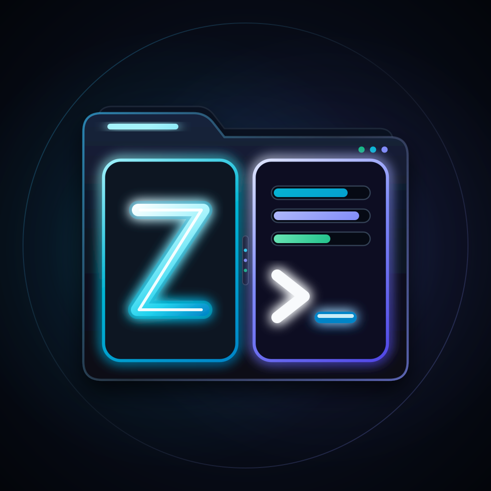
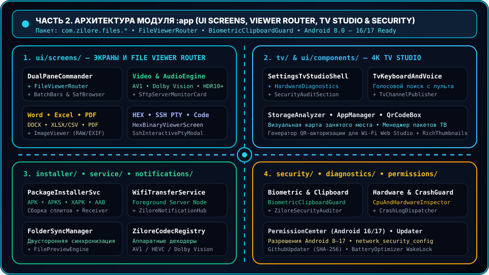
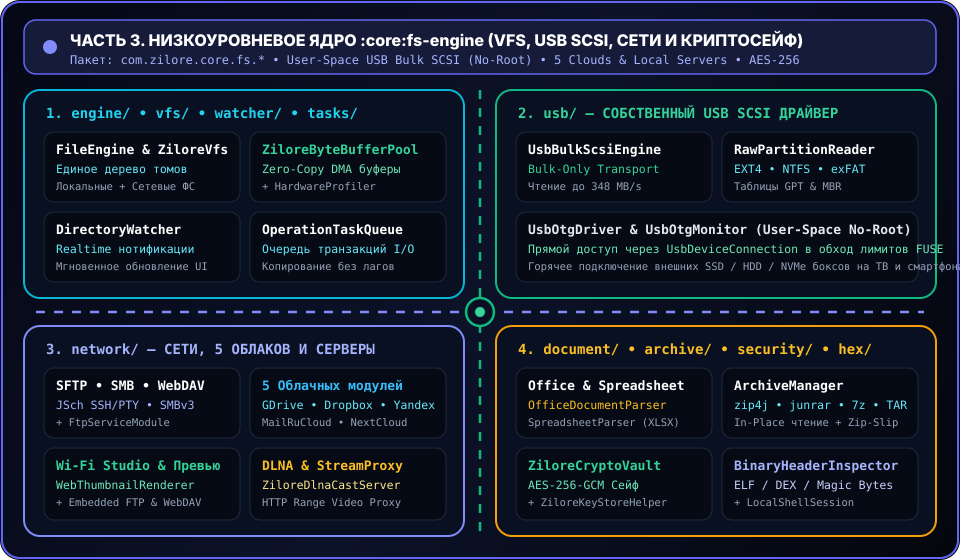

<div align="center">
  <a href="https://zilore.app">
    
  </a>
  <h1>⚡ Zilore Files</h1>
  <p><strong>Системный двухпанельный файловый менеджер, сетевой хаб и аппаратный медиа-комбайн для Android &amp; Android TV (Android 8.0 – 17 Ready)</strong></p>
  <p>
    <a href="https://zilore.app"></a>
    <a href="https://t.me/zilorefiles"></a>
    <a href="https://t.me/zilorechat"></a>
  </p>
</div>

---

## 🏗 Архитектура проекта (`:app` + `:core:fs-engine`)

### 1. Полнодуплексный мост данных `Zilore VFS Bridge`
<p align="center"></p>

### 2. Пользовательский модуль `:app` (UI Screens, FileViewerRouter, 4K TV Studio & BiometricGuard)
<p align="center"></p>

### 3. Низкоуровневое ядро `:core:fs-engine` (VFS, USB SCSI, 5 Clouds & CryptoVault)
<p align="center"></p>

---

## 📦 Спецификация модулей и совместимость с Android 16 / 17

<table>
  <thead>
    <tr>
      <th width="24%">Модуль и слой</th>
      <th width="22%">Пакеты</th>
      <th width="54%">Ключевые классы и назначение</th>
    </tr>
  </thead>
  <tbody>
    <tr>
      <td><b><code>:app</code><br>Explorer &amp; Router UI</b></td>
      <td><code>ui/screens/</code></td>
      <td><code>ExplorerDualPaneCommander</code>, <code>ExplorerScreen</code>, <code>FileViewerRouter</code>, <code>ExplorerBatchAndClipboardBars</code>, <code>ExplorerSafBrowserList</code>, <code>ExplorerActionModals</code>, <code>NetworkScreen</code>, <code>SftpServerMonitorCard</code></td>
    </tr>
    <tr>
      <td><b><code>:app</code><br>TV Studio &amp; Settings</b></td>
      <td><code>tv/</code><br><code>ui/screens/</code><br><code>ui/components/</code></td>
      <td><code>SettingsTvStudioShell</code>, <code>SettingsHardwareDiagnosticsSection</code>, <code>SettingsSecurityAuditSection</code>, <code>ZiloreTvChannelPublisher</code>, <code>ZiloreTvKeyboardAndVoice</code>, <code>ZiloreStorageAnalyzerDialog</code></td>
    </tr>
    <tr>
      <td><b><code>:app</code><br>Security &amp; Android 16/17</b></td>
      <td><code>security/</code><br><code>permissions/</code><br><code>diagnostics/</code></td>
      <td><code>ZiloreBiometricAndClipboardGuard</code>, <code>ZilorePermissionCenter</code> <b>(Android 8.0 – 16 / 17 Ready)</b>, <code>ZiloreCpuAndHardwareInspector</code>, <code>ZiloreSecurityAuditor</code>, <code>ZiloreCrashLogDispatcher</code>, <code>GithubUpdater</code>, <code>ZiloreBatteryOptimizer</code></td>
    </tr>
    <tr>
      <td><b><code>:core:fs-engine</code><br>VFS &amp; USB SCSI</b></td>
      <td><code>engine/</code>, <code>vfs/</code><br><code>usb/</code>, <code>watcher/</code></td>
      <td><code>FileEngine</code>, <code>ZiloreVfs</code>, <code>ZiloreByteBufferPool</code> (Zero-Copy), <code>UsbBulkScsiEngine</code> (до <code>348 MB/s</code>), <code>UsbRawPartitionReader</code> (<code>EXT4</code>/<code>NTFS</code>/<code>exFAT</code>), <code>UsbOtgDriver</code>, <code>RealtimeDirectoryWatcher</code></td>
    </tr>
    <tr>
      <td><b><code>:core:fs-engine</code><br>Network, 5 Clouds &amp; Vault</b></td>
      <td><code>network/</code><br><code>security/</code><br><code>document/</code>, <code>archive/</code></td>
      <td><code>SftpServiceModule</code>, <code>SmbServiceModule</code>, <code>WebDavServiceModule</code>; <b>5 Облаков:</b> <code>GoogleDrive</code>, <code>Dropbox</code>, <code>YandexDisk</code>, <code>MailRuCloud</code>, <code>NextCloud</code>; <code>ZiloreWifiTransferServer</code>, <code>ZiloreCryptoVault</code> (<code>AES-256-GCM</code>), <code>OfficeDocumentParser</code>, <code>SpreadsheetParser</code>, <code>ArchiveManager</code></td>
    </tr>
  </tbody>
</table>

---

## 🛡 Проверка подлинности SHA-256 (`ZiloreFiles-universal.apk`)

```text
8f434346648f6b96df89dda901c5176b10a6d83961dd3c1ac88b59b2dc327aa4
```
