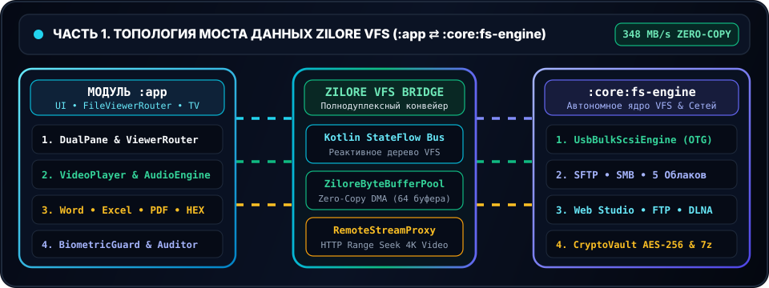
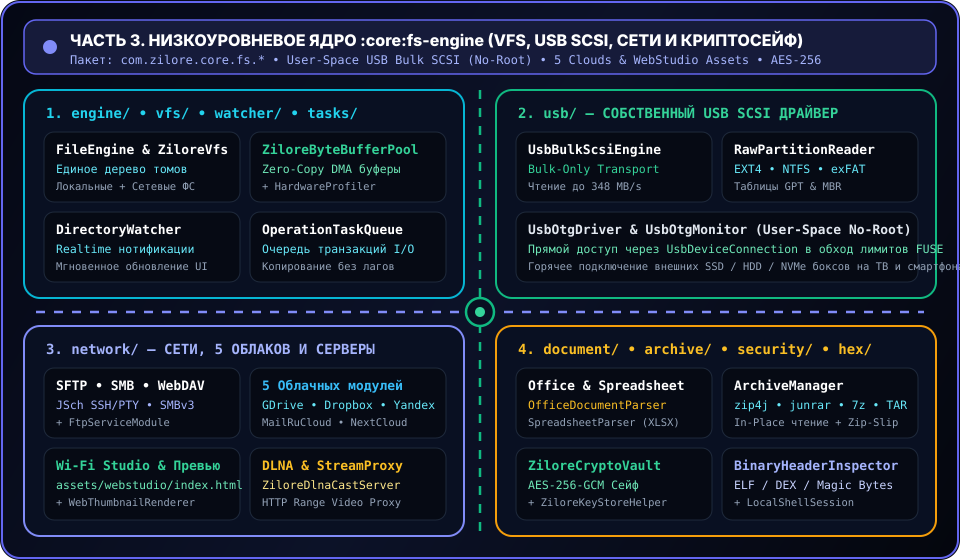

<div align="center">

  <a href="https://zilore.app">
    
  </a>

  <h1>⚡ Zilore Files</h1>

  <p>
    <strong>Системный двухпанельный файловый менеджер, сетевой хаб и аппаратный медиа-комбайн для Android &amp; Android TV (Android 8.0 – 17 Ready)</strong>
  </p>

  <p>
    <a href="https://zilore.app"></a>
    <a href="https://t.me/zilorefiles"></a>
    <a href="https://t.me/zilorechat"></a>
  </p>

  <p>
    
    
    
    
    
    
  </p>

  <h4>
    <a href="#-архитектура-проекта">🏗 Архитектура</a> •
    <a href="#-ключевые-возможности">✨ Возможности</a> •
    <a href="#-конвейеры-потоков-данных">🔄 Потоки данных</a> •
    <a href="#-управление-на-android-tv">🎮 Пульт ТВ</a> •
    <a href="#-производительность-и-стек">🚀 Бенчмарки</a> •
    <a href="#-сборка-и-тестирование">⚙️ Сборка</a> •
    <a href="#-безопасность-и-проверка-sha-256">🛡 SHA-256</a> •
    <a href="#-технический-faq">❓ FAQ</a> •
    <a href="#-сообщество-и-поддержка">💬 Сообщество</a>
  </h4>

</div>

---

> 🌐 **Интерактивный веб-стенд и проверка APK:** откройте официальный портал **[zilore.app](https://zilore.app)** (или локальный файл [`index.html`](./index.html)), чтобы протестировать двухпанельный командир `ExplorerDualPaneCommander` прямо в браузере, изучить экранные модули и локально сверить контрольную сумму `SHA-256` скачанного `.apk` файла через Web Crypto API.

**Zilore Files** — многофункциональное двухпанельное приложение на базе выделенной модульной архитектуры (`:app` + `:core:fs-engine`) для смартфонов, планшетных ПК, ТВ-приставок и **4K Smart TV** (с поддержкой спецификаций вплоть до **Android 16 / 17**). Объединяет низкоуровневый драйвер `UsbBulkScsiEngine` для чтения/записи **EXT4 / NTFS / exFAT** без Root-прав, мультипротокольный сетевой хаб и **5 облачных клиентов** (**SFTP, SMB, FTP, WebDAV, DLNA + Google Drive, Dropbox, Yandex Disk, Mail.ru Cloud, NextCloud**), единый маршрутизатор форматов `FileViewerRouter`, студийную ТВ-оболочку `SettingsTvStudioShell`, аппаратный медиаплеер **AV1 / Dolby Vision / Hi-Res Audio**, встроенный просмотрщик **Word (DOCX), Excel (XLSX/CSV), PDF и графики**, **HEX-инспектор**, биометрическую защиту `ZiloreBiometricAndClipboardGuard` и криптосейф **ZiloreCryptoVault (AES-256-GCM)**.

---

## 🏗 Архитектура проекта

Проект разделён на два независимых Gradle-модуля (`:app` и `:core:fs-engine`), связанных полнодуплексным реактивным мостом `Zilore VFS Bridge`. Для идеальной читаемости на любых экранах архитектура визуализирована в **3 отдельных широкоформатных анимированных SVG-схемах**:

### 1. Полнодуплексный мост данных `Zilore VFS Bridge` (`:app ⇄ :core:fs-engine`)
Отображает обмен состояниями и данными между пользовательским интерфейсом и низкоуровневым файловым ядром через `Kotlin StateFlow`, пул прямых буферов `ZiloreByteBufferPool (Zero-Copy DMA)` и потоковый прокси `ZiloreRemoteStreamProxy`:

<p align="center">
  
</p>

### 2. Пользовательский модуль `:app` (UI Screens, FileViewerRouter, 4K TV Studio & Security)
Раскрывает 4 подсистемы уровня приложения: модульный проводник, маршрутизатор `FileViewerRouter` и экранные комбайны (`ui/screens/`), студийную оболочку `SettingsTvStudioShell` с секциями `SettingsHardwareDiagnosticsSection` и `SettingsSecurityAuditSection` для **4K Android TV** (`tv/` и `ui/components/`), фоновые службы, центр уведомлений `ZiloreNotificationHub` и инсталлятор сплитов (`installer/`, `service/`, `sync/`), а также биометрическую защиту `ZiloreBiometricAndClipboardGuard` и диагностический комплекс (`ZiloreCpuAndHardwareInspector`, `ZiloreSecurityAuditor`, `ZiloreCrashLogDispatcher`):

<p align="center">
  
</p>

### 3. Низкоуровневое ядро `:core:fs-engine` (VFS, USB SCSI, 5 Clouds & CryptoVault)
Детализирует 4 системных ядра: виртуальную файловую систему (`FileEngine`, `ZiloreByteBufferPool`, `RealtimeDirectoryWatcher`), собственный **User-Space USB Bulk SCSI драйвер** (`UsbBulkScsiEngine`, `UsbRawPartitionReader` без Root-прав), сетевой и облачный стек (`SFTP/SMB/WebDAV/DLNA` + **5 Облаков** + встроенные серверы с `assets/webstudio/index.html` и `ZiloreWebThumbnailRenderer`) и криптосейф `ZiloreCryptoVault (AES-256-GCM)`:

<p align="center">
  
</p>

### Спецификация модулей и пакетов

| Модуль / Слой | Пакет | Ключевые классы и назначение |
| :--- | :--- | :--- |
| **`:app` (Explorer & Router UI)** | `ui/screens/` | `ExplorerDualPaneCommander`, `ExplorerScreen`, `FileViewerRouter`, `ExplorerBatchAndClipboardBars`, `ExplorerSafBrowserList`, `ExplorerActionModals`, `NetworkScreen`, `NetworkLocalServersSection`, `NetworkRemoteFileBrowserSection`, `NetworkUsbOtgSection`, `SftpServerMonitorCard` |
| **`:app` (Media, Office & Dev)** | `ui/screens/` | `VideoPlayer`, `ZiloreAudioEngine`, `AudioPlayerScreen`, `WordDocumentScreen`, `SpreadsheetViewerScreen`, `PdfViewerScreen`, `EditorPdfScreen`, `ImageViewerScreen`, `HexBinaryViewerScreen`, `SshInteractivePtyModal`, `TerminalScreen`, `TextEditorScreen`, `ArchiveViewerModal` |
| **`:app` (TV Studio & Settings)** | `tv/`, `ui/screens/`, `ui/components/` | `SettingsTvStudioShell`, `SettingsHardwareDiagnosticsSection`, `SettingsSecurityAuditSection`, `ZiloreTvChannelPublisher`, `ZiloreTvKeyboardAndVoice`, `ZiloreTvModifiers`, `ZiloreStorageAnalyzerDialog`, `ZiloreAppManagerDialog`, `ZiloreQrCodeBox`, `StorageVolumeCard`, `FileRichThumbnailBox` |
| **`:app` (Services & Hub)** | `installer/`, `service/`, `sync/`, `notifications/`, `media/` | `PackageInstallerService`, `InstallReceiver`, `WifiTransferForegroundService`, `FolderSyncManager`, `ZiloreNotificationHub`, `FilePreviewEngine`, `ZiloreCodecRegistry` |
| **`:app` (Security & Diagnostics)** | `security/`, `diagnostics/`, `updater/`, `permissions/`, `power/` | `ZiloreBiometricAndClipboardGuard`, `ZiloreCpuAndHardwareInspector`, `ZiloreSecurityAuditor`, `ZiloreCrashLogDispatcher`, `ZiloreAnonymousDiagnostics`, `GithubUpdater`, `ZilorePermissionCenter` (Android 8–17), `ZiloreBatteryOptimizer`, `ZiloreSettingsStore` |
| **`:core:fs-engine` (VFS & USB)** | `engine/`, `vfs/`, `watcher/`, `tasks/`, `usb/` | `FileEngine`, `ZiloreVfs`, `ZiloreByteBufferPool` (Zero-Copy), `ZiloreHardwareProfiler`, `RealtimeDirectoryWatcher`, `FileOperationTaskQueue`, `UsbBulkScsiEngine` (до `348 MB/s`), `UsbRawPartitionReader` (`EXT4`/`NTFS`/`exFAT`), `UsbOtgDriver`, `UsbOtgMonitor` |
| **`:core:fs-engine` (Network & 5 Clouds)** | `network/`, `assets/webstudio/` | `SftpServiceModule`, `SmbServiceModule`, `FtpServiceModule`, `WebDavServiceModule`, **5 Облаков:** `GoogleDriveServiceModule`, `DropboxServiceModule`, `YandexDiskServiceModule`, `MailRuCloudServiceModule`, `NextCloudServiceModule`; **Серверы:** `ZiloreWifiTransferServer`, `ZiloreWebStudioTemplate`, `ZiloreWebThumbnailRenderer`, `ZiloreEmbeddedFtpServer`, `ZiloreEmbeddedWebDavServer`, `ZiloreDlnaCastServer`, `ZiloreRemoteStreamProxy`, `ZiloreLocalTlsProvider` |
| **`:core:fs-engine` (Parsers & Vault)** | `document/`, `spreadsheet/`, `archive/`, `security/`, `inspector/` | `OfficeDocumentParser` (`DOCX`), `SpreadsheetParser` (`XLSX`/`CSV`), `ArchiveManager` (`zip4j`/`junrar`/`7z`/`TAR`), `ZiloreCryptoVault` (`AES-256-GCM`), `ZiloreKeyStoreHelper`, `BinaryHeaderInspector`, `LocalShellSession` |

---

## 🛡 Безопасность и проверка SHA-256

Перед установкой APK-файла рекомендуется сверить его контрольную сумму `SHA-256` (вручную через терминал, автоматически через встроенный `GithubUpdater` или локально в браузере на странице **[zilore.app](https://zilore.app)**).

* **Имя пакета:** `ZiloreFiles-universal.apk` (`ARM64-v8a` / `armeabi-v7a` / `x86_64`)
* **Эталонный `SHA-256`:**
  ```text
  8f434346648f6b96df89dda901c5176b10a6d83961dd3c1ac88b59b2dc327aa4
  ```

### Матрица защиты подсистем (`Security Hardening v26.1`)

| Узел / Компонент | Вектор угрозы | Реализованная защита в Zilore Files |
| :--- | :--- | :--- |
| **`ZiloreCryptoVault`** | Несанкционированный доступ к приватным файлам | Шифрование `AES-256-GCM` с хранением мастер-ключей в аппаратном `Android Keystore (TEE)` |
| **`BiometricClipboardGuard`** | Перехват паролей из буфера обмена и несанкционированный вход | Биометрическая верификация и автоматическая очистка буфера обмена по таймеру |
| **`ZiloreSecurityAuditor`** | Компрометация среды исполнения или сетевых политик | Аудит SELinux, Keystore, `network_security_config.xml` и прав Android 16/17 |
| **`ArchiveManager`** | *Zip-Slip (Path Traversal)* при распаковке архивов | Каноническая проверка путей `File.canonicalPath` до записи любого байта на диск |
| **`WifiTransferServer`** | Перехват трафика в локальной Wi-Fi сети | Генерация сертификатов в `ZiloreLocalTlsProvider` (HTTPS) + авторизация по QR-коду |
| **`ZiloreCrashLogDispatcher`** | Утечка приватных путей и имён файлов в логах | Полное отсутствие фоновой телеметрии; санитизация стектрейсов в `ZiloreAnonymousDiagnostics` |

---

## 💬 Сообщество и поддержка

* 🌐 **Официальный сайт и проверка SHA-256:** [https://zilore.app](https://zilore.app)
* 📢 **Telegram-канал релизов:** [@zilorefiles](https://t.me/zilorefiles)
* 💬 **Технический форум поддержки:** [@zilorechat](https://t.me/zilorechat)
* 📧 **Почта для отчётов и предложений:** [ziloreapp@gmail.com](mailto:ziloreapp@gmail.com)
